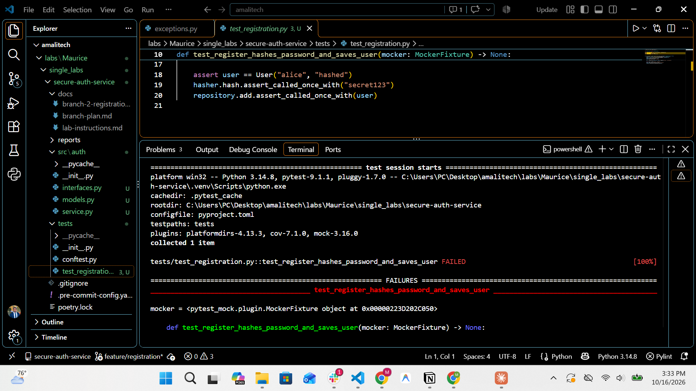
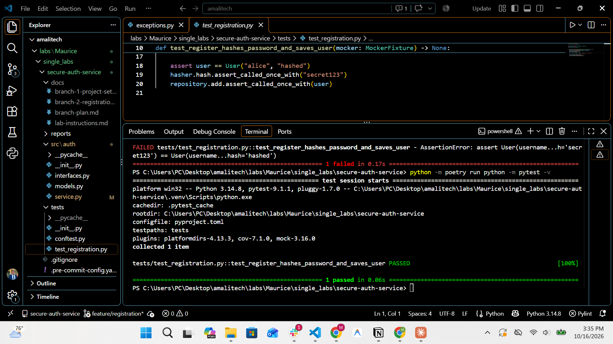
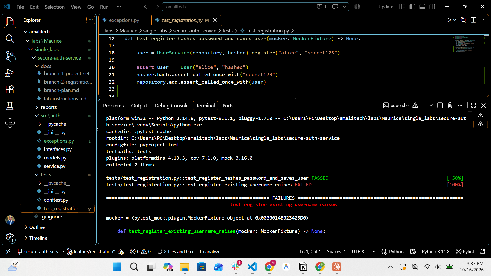
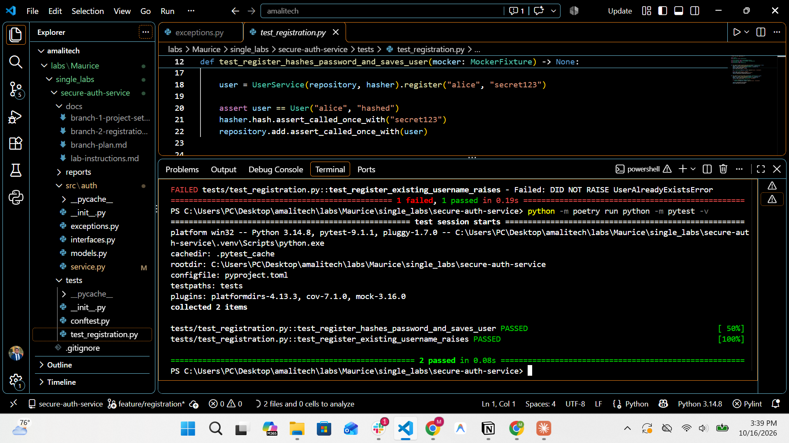
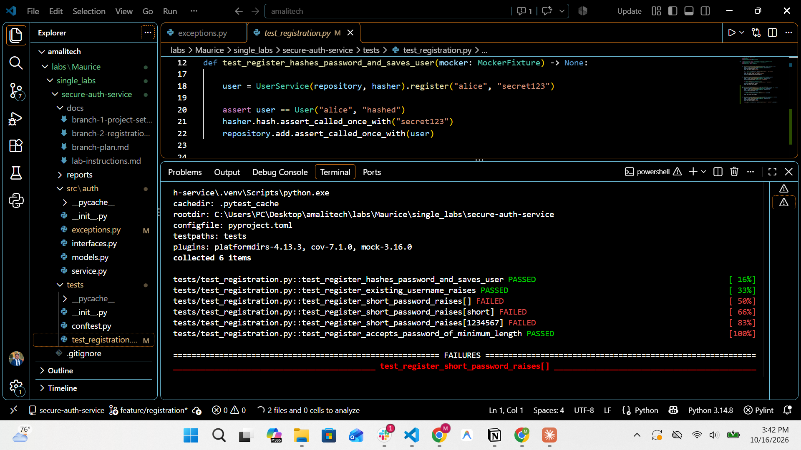
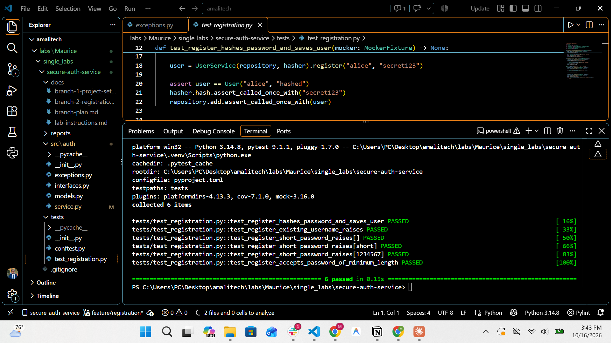
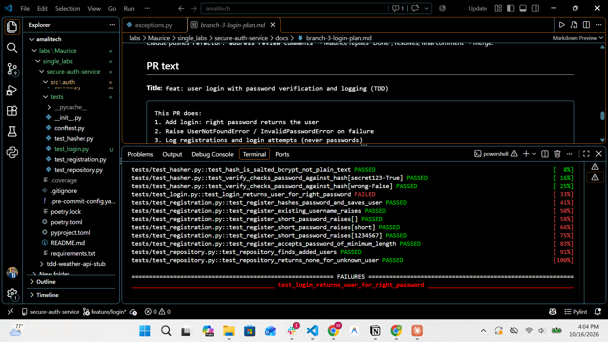
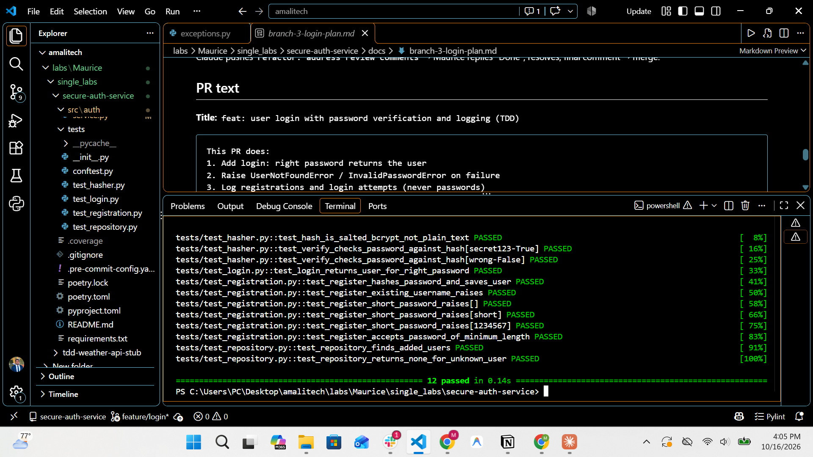
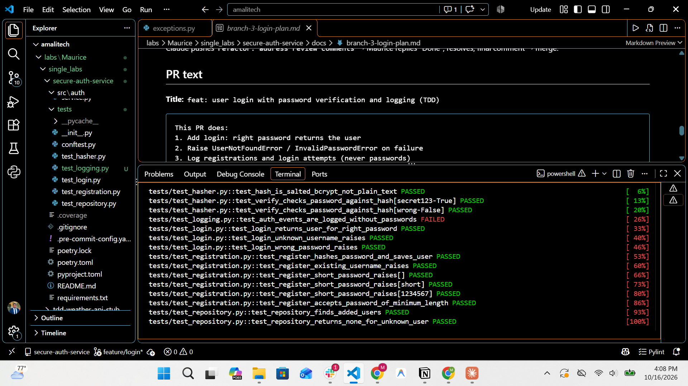
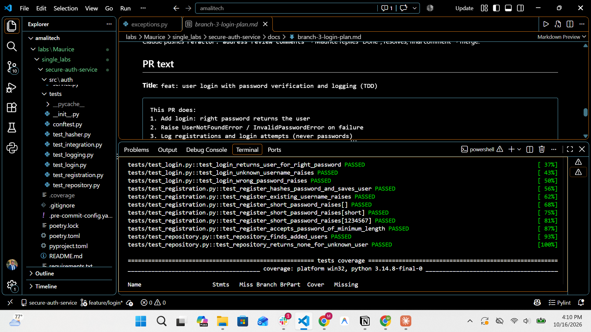

# Secure Auth Service (TDD)

A small, reusable **user authentication library** in Python: registration and login
with **bcrypt** password hashing, a password policy, custom errors and structured
logging. Built with strict **Test-Driven Development** and **SOLID** design.


---

## Features

- `register(username, password)`: password policy (min. 8 characters), duplicate check,
  bcrypt hashing; only the hash is stored
- `login(username, password)`: verifies the password against the stored hash
- Custom errors: `UserAlreadyExistsError`, `InvalidPasswordError`, `UserNotFoundError`
  (all inherit from `AuthError`)
- Structured logging with levels (passwords are never logged):
  - INFO: successful registration and login
  - WARNING: failed registration (short password, username taken) and failed login (unknown user, wrong password)
- Thread-safe registration: two users can never take the same username at the same time
- Storage and hashing are injected, so they can be swapped or mocked

## Setup

```bash
git clone https://github.com/Molyceo12/Secure-Auth-Service-TDD.git
cd Secure-Auth-Service-TDD
python -m pip install poetry          # if Poetry is not installed
python -m poetry install
python -m poetry run python -m pre_commit install
```

Without Poetry: `python -m pip install -r requirements.txt` then `python -m pip install -e .`

## Usage

```python
from auth.hasher import BcryptPasswordHasher
from auth.repository import InMemoryUserRepository
from auth.service import UserService

service = UserService(InMemoryUserRepository(), BcryptPasswordHasher())

service.register("alice", "secret123")   # User(username='alice', password_hash='$2b$12$...')
service.login("alice", "secret123")      # returns the same user
service.login("alice", "wrong-pass")     # InvalidPasswordError
service.register("bob", "123")           # InvalidPasswordError (too short)
service.register("alice", "secret123")   # UserAlreadyExistsError
service.login("carol", "secret123")      # UserNotFoundError
```

### Demo

Run 11 registration and login cases (successes, failures and edge cases) with one
command. Each case shows the expected and actual outcome, followed by a table of the
logs and a summary:

```bash
python -m poetry run python examples/demo.py
```

```
:: LOGIN ::::::::::::::::::::::::::::::::::::::::::::::::::::::::::::::::::::::::
+----+--------------------------------------+----------------------+----------------------------------------+-------+
| #  | Case                                 | Expected             | Actual                                 | Check |
+====+======================================+======================+========================================+=======+
| 6  | alice / secret123                    | OK                   | OK ($2b$12$pzx...)                     | PASS  |
| 7  | bob / exactly8                       | OK                   | OK ($2b$12$tqq...)                     | PASS  |
| 8  | alice / wrong-pass                   | InvalidPasswordError | InvalidPasswordError: Wrong password   | PASS  |
| 9  | alice / SECRET123 (wrong case)       | InvalidPasswordError | InvalidPasswordError: Wrong password   | PASS  |
| 10 | carol (was rejected at register)     | UserNotFoundError    | UserNotFoundError: No user named carol | PASS  |
| 11 | Alice (usernames are case-sensitive) | UserNotFoundError    | UserNotFoundError: No user named Alice | PASS  |
+----+--------------------------------------+----------------------+----------------------------------------+-------+

Summary: 11 cases | 4 succeeded | 7 rejected | 11/11 behaved as expected
```

## SOLID architecture

```
                 ┌───────────────┐
   your code ──► │  UserService  │  register / login, password policy, logging
                 └───┬───────┬───┘
       depends on    │       │    depends on
      (interfaces)   ▼       ▼
        ┌────────────────┐ ┌────────────────┐
        │ UserRepository │ │ PasswordHasher │   ABCs in interfaces.py
        └───────┬────────┘ └───────┬────────┘
                ▼                  ▼
   InMemoryUserRepository   BcryptPasswordHasher   concrete implementations
```

| Principle | How it is applied |
|---|---|
| **S**ingle responsibility | the service holds the rules; the repository stores; the hasher hashes |
| **O**pen/closed | a new storage (e.g. a database) is a new `UserRepository`; the service does not change |
| **L**iskov substitution | any repository / hasher (real or mock) works in `UserService` |
| **I**nterface segregation | two small interfaces: `get`/`add` and `hash`/`verify` |
| **D**ependency inversion | `UserService(repository, hasher)` receives abstractions through its constructor (dependency injection) |

| File | Content |
|---|---|
| `src/auth/models.py` | `User` dataclass (`username`, `password_hash`) |
| `src/auth/exceptions.py` | `AuthError` and the 3 custom errors |
| `src/auth/interfaces.py` | `UserRepository`, `PasswordHasher` |
| `src/auth/repository.py` | `InMemoryUserRepository` |
| `src/auth/hasher.py` | `BcryptPasswordHasher` |
| `src/auth/service.py` | `UserService` |

## Security notes

- Passwords are hashed with **bcrypt** (cost 12) and a **new random salt** each time,
  so equal passwords give different hashes
- Verification uses `bcrypt.checkpw` (constant-time comparison)
- Plain passwords are **never stored or logged**; logs only contain usernames and events
- **Thread-safe registration**: the "is the name free?" check and the save run inside
  `with self._register_lock:`, so concurrent registrations cannot both take one username.
  Slow bcrypt hashing stays outside the lock, and a quick check before hashing rejects
  known duplicates without wasting a hash

## Modern Python features

| Feature | Where |
|---|---|
| Type hints everywhere, checked by **mypy (strict)** | all of `src/`, `tests/`, `examples/` (`User \| None`, `type[AuthError]`, ...) |
| Context manager: `threading.Lock` | `with self._register_lock:` in `UserService.register` (always released, even on error) |
| Context manager: `ThreadPoolExecutor` | `tests/test_concurrency.py` runs and cleanly shuts down the threads |
| Context manager: `pytest.raises` | every test that expects an error |
| `@dataclass(frozen=True)` | immutable `User` |
| Abstract base classes | `UserRepository`, `PasswordHasher` |

## TDD process

Every feature followed **red → green → refactor**, and the commit history shows it
(`test: ... (red)` → `feat: ... (green)` → `refactor: ...`):

| Feature | 🔴 Red | 🟢 Green |
|---|---|---|
| Register | register hashes the password and saves the user | register users with hashed passwords |
| Duplicates | registering an existing username raises UserAlreadyExistsError | reject duplicate usernames |
| Password policy | short passwords raise InvalidPasswordError | enforce a minimum password length |
| Storage | in-memory repository stores and finds users | add InMemoryUserRepository |
| Hashing | bcrypt hasher hashes and verifies passwords | add BcryptPasswordHasher |
| Login | login returns the user for the right password | log in users with the right password |
| Unknown user | login with unknown username raises UserNotFoundError | reject unknown usernames on login |
| Wrong password | login with wrong password raises InvalidPasswordError | reject wrong passwords on login |
| Logging | auth events are logged without passwords | log registrations and login attempts |
| Failed registrations | failed registrations are logged as warnings | log failed registrations as warnings |
| Thread safety | concurrent registrations of one username allow only one | make registration thread-safe with a lock |

Red commits contain the failing test and only an empty stub, so pre-commit (mypy)
still passes while the test fails for the right reason.

| 🔴 Red | 🟢 Green |
|---|---|
|  |  |
|  |  |
|  |  |
|  |  |
|  |  |

## Testing

```bash
python -m poetry run python -m pytest -v
python -m poetry run python -m pytest --cov --cov-report=term-missing
```

**23 tests, 100% statement and branch coverage** (the run fails below 100%), see
[`reports/coverage.txt`](reports/coverage.txt).

| Test file | Covers | Techniques |
|---|---|---|
| `test_registration.py` | register, duplicates, password policy | `pytest-mock` (mocked repository and hasher), `parametrize`, `pytest.raises` |
| `test_login.py` | login success and failures | `pytest-mock`, `pytest.raises` |
| `test_logging.py` | each auth event is logged at the right level (INFO / WARNING), no passwords in logs | `caplog`, autouse fixture |
| `test_repository.py` | in-memory storage | plain asserts |
| `test_hasher.py` | real bcrypt hashing and verification | fixture |
| `test_integration.py` | register + login with real parts | no mocks |
| `test_concurrency.py` | 10 threads register one username at once, only 1 succeeds | `threading.Barrier`, `ThreadPoolExecutor`, slow repository |

Shared fixtures in `tests/conftest.py` provide a mocked repository, a mocked hasher
and a service wired to them.

## Code quality

Black, ruff, pylint and mypy (strict) run on every commit through pre-commit:

```bash
python -m poetry run python -m pre_commit run --all-files
```

All public classes and methods have Google-style docstrings and type hints.

## Git workflow

Git Flow: `main` (releases), `develop` (integration), short `feature/*` branches merged
into `develop` through pull requests with a simulated code review (line comments → fix
commit → sign-off).

| PR | Branch | Content |
|---|---|---|
| #1 | `chore/project-setup` | tooling, bcrypt, pre-commit, PR template |
| #2 | `feature/registration` | interfaces, register, repository, bcrypt hasher |
| #3 | `feature/login` | login, errors, logging |
| #4 | `docs/coverage-and-readme` | demo, docstrings, README, coverage report |

Releases go from `develop` to `main` through `release/*` and are tagged (`v1.0.0`).
